<div dir="rtl">

<p align="center"></p>

<h1 align="center">سعي — اسعَ تُعفَ.</h1>

<p align="center">تطبيق أندرويد لطلاب المدارس في العراق — <b>من الأول المتوسط حتى الخامس الإعدادي</b><br/>(عدا الصفوف المنتهية: الثالث المتوسط والسادس الإعدادي)، مع لوحة تحكم كاملة للإدارة.<br/>
تصميم وبرمجة <b>محمد حازم احمد</b>.</p>

<p align="center">
  <a href="https://saeyiq.web.app/">الموقع الرسمي</a> ·
  <a href="videos/01-app-tour.mp4">فيديو الجولة الكاملة</a> ·
  <a href="https://saeyiq.web.app/showcase/">صفحة العرض</a>
</p>

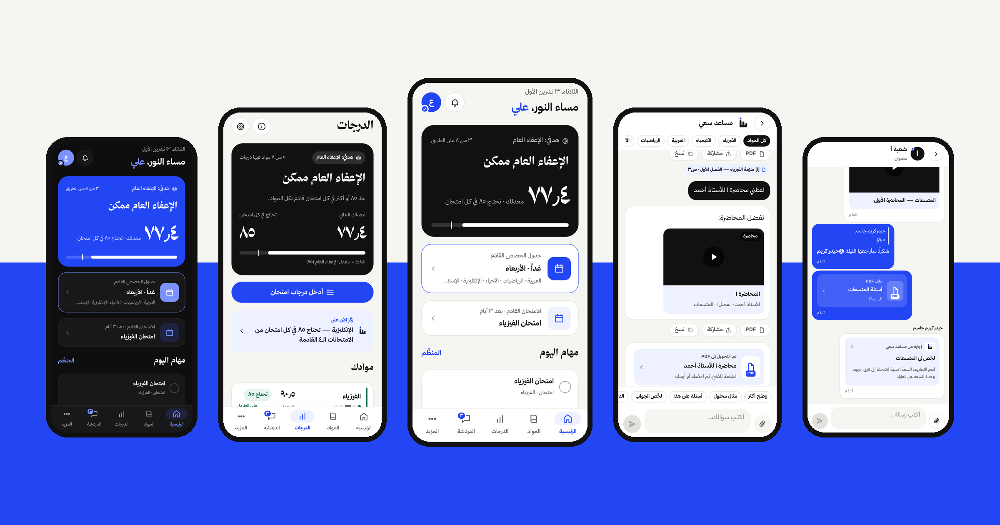

## الفكرة

كل طالب في العراق يسأل نفس السؤال طوال السنة: **«كم أحتاج حتى أُعفى؟»**
والمحاضرات في يوتيوب، والملازم في مجموعات تلغرام، والأسئلة المتوقعة صور متفرقة، والدرجات على ورقة.

«سعي» يجمع كل هذا في تطبيق واحد عربي بالكامل، مصمم للمناهج العراقية وضوابط الإعفاء، لكل الصفوف من الأول المتوسط حتى الخامس الإعدادي (عدا الثالث المتوسط والسادس الإعدادي لأنها صفوف وزارية):
تدخل درجاتك، والتطبيق يحسب سعيك السنوي ويقول لك بجملة واحدة كم تحتاج في كل امتحان قادم.

## جولة سريعة

| الجولة الكاملة | الدرجات والإعفاء | المساعد الذكي | الوضع الداكن |
|:---:|:---:|:---:|:---:|
|  |  |  |  |
| [▶ MP4 · ٥٠ ث](videos/01-app-tour.mp4) | [▶ MP4 · ٢٤ ث](videos/02-grades-exemption.mp4) | [▶ MP4 · ١٩ ث](videos/03-ai-assistant.mp4) | [▶ MP4 · ٣٢ ث](videos/04-dark-mode.mp4) |

## المميزات

### للطالب
- **الدرجات والإعفاء** — يحسب السعي السنوي، والإعفاء الفردي (٩٠ في المادة) والعام (معدل ٨٥ وبلا مادة تحت ٧٥)، ودرجة النجاح، وكم يحتاج الطالب في كل امتحان قادم. هدف قابل للاختيار: النجاح، إعفاء مواد، أو الإعفاء العام.
- **كل مواد الصف** — لكل مادة: المحاضرات (يوتيوب) مقسمة حسب الكتاب والفصل مع تتبع ما شوهد، والملازم PDF مع فهرس للفصول والمواضيع، والأسئلة المتوقعة لكل شهر، وأسئلة امتحانات المدرسة الفعلية.
- **الملازم بلا إنترنت** — عارض PDF مدمج، وتحميل للقراءة دون اتصال.
- **مساعد سعي (ذكاء اصطناعي)** — يجيب من ملازم الصف نفسها ويذكر المصدر والصفحة، يقترح المحاضرة المناسبة، يحوّل الإجابة إلى PDF، ويكتب المعادلات بشكل صحيح.
- **مواضيع المحاضرة** — كل محاضرة مقسّمة إلى مواضيع بتوقيتها، تقفز للجزء الذي تريده.
- **الدردشة** — محادثة لكل شعبة وللمدرسة كلها ورسائل خاصة؛ ردود، إشارات @، تفاعلات، وإرفاق محاضرة أو ملزمة أو ملف أو إجابة المساعد.
- **الجداول** — جدول الحصص الأسبوعي لكل شعبة، وجداول الامتحانات بعدّاد للأيام.
- **المنظِّم** — الواجبات والتحضيرات والامتحانات مع تذكير قبل الموعد.
- **مؤقت الدراسة** — جلسات تركيز (بومودورو) يعمل في الخلفية بإشعار حي، وإحصائيات دراسة أسبوعية.
- **تحويل ورقة إلى PDF** — صوّر ورقة الأسئلة، والتطبيق يحسّنها ويحوّلها لملف نظيف.
- **ويدجتات** على الشاشة الرئيسية للهاتف: المعدل، الامتحان القادم، المهام.
- **الأخبار والإشعارات** — العطل والأخبار تصل فوراً بإشعار.
- **وضع داكن** كامل، وأرقام عربية، وخط «ثمانية».

### للإدارة (لوحة التحكم على الويب)
- قبول الطلاب الجدد (الدخول بموافقة الأدمن فقط) وإدارة الشعب والأدوار.
- رفع المحاضرات والملازم والأسئلة، و**فهرسة الملازم بالذكاء الاصطناعي** على الخادم (حتى يجيب المساعد منها).
- محرر أسئلة يحوّل صور الامتحانات إلى نص مع المعادلات.
- الجداول، الأخبار، الواجبات، الدردشة، إحصائيات الاستخدام، وسجل العمليات.

## صور التطبيق

<table>
<tr>
<td align="center">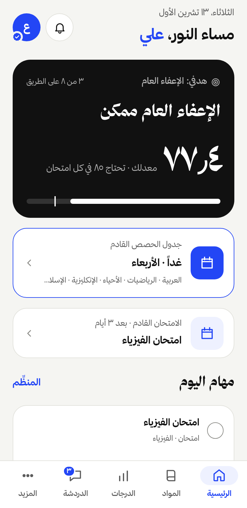<br/>الرئيسية</td>
<td align="center">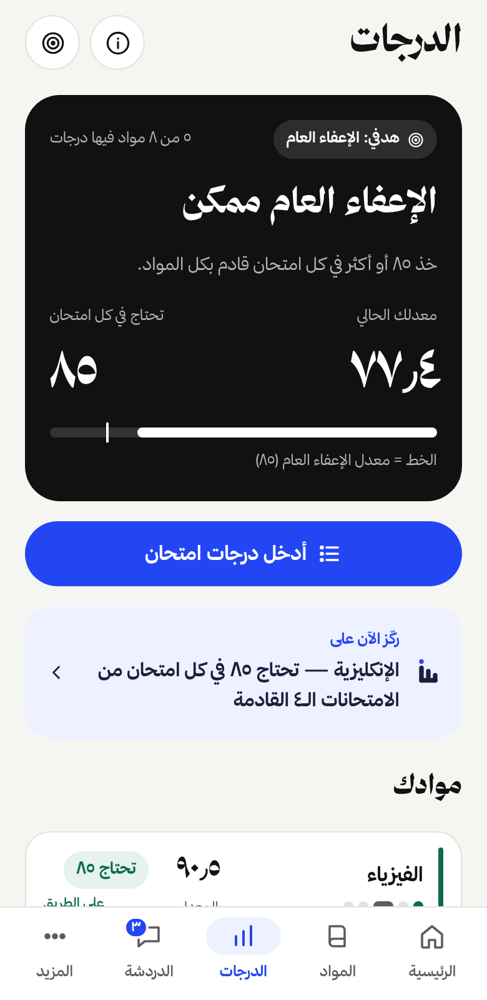<br/>الدرجات</td>
<td align="center">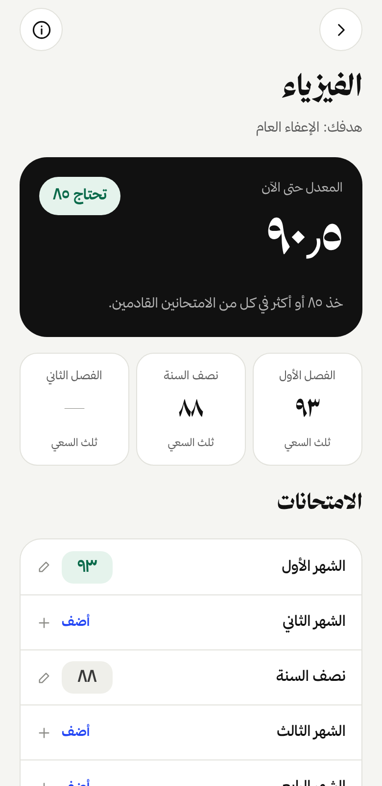<br/>درجات مادة</td>
<td align="center">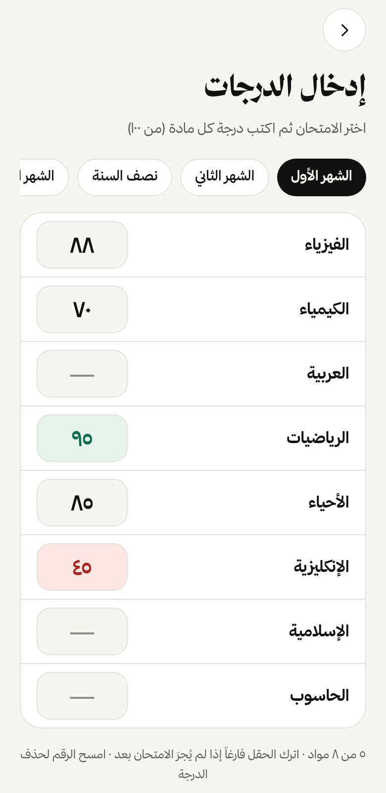<br/>إدخال الدرجات</td>
</tr>
<tr>
<td align="center">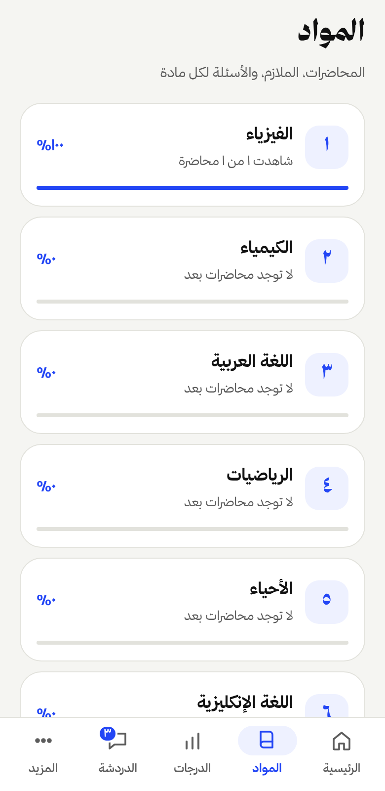<br/>المواد</td>
<td align="center">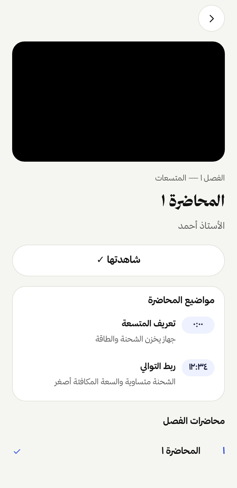<br/>محاضرة ومواضيعها</td>
<td align="center">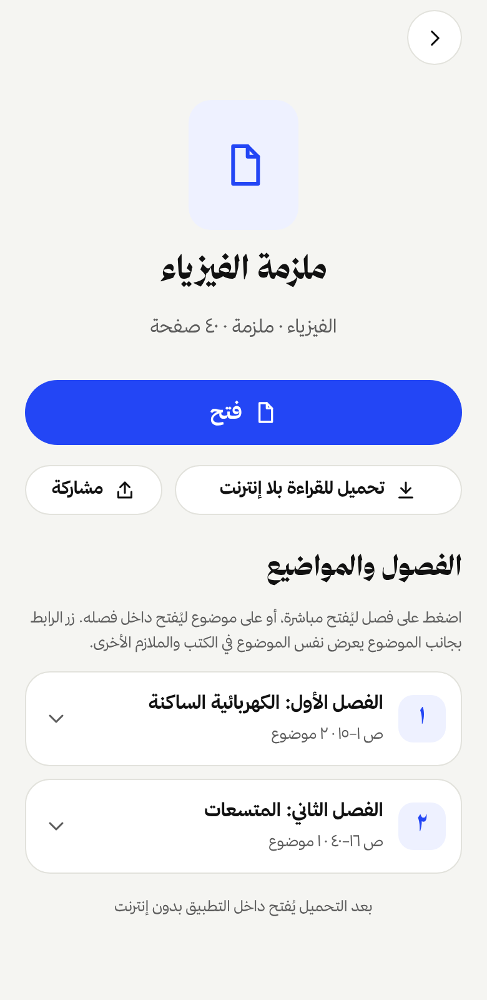<br/>ملزمة وفهرسها</td>
<td align="center">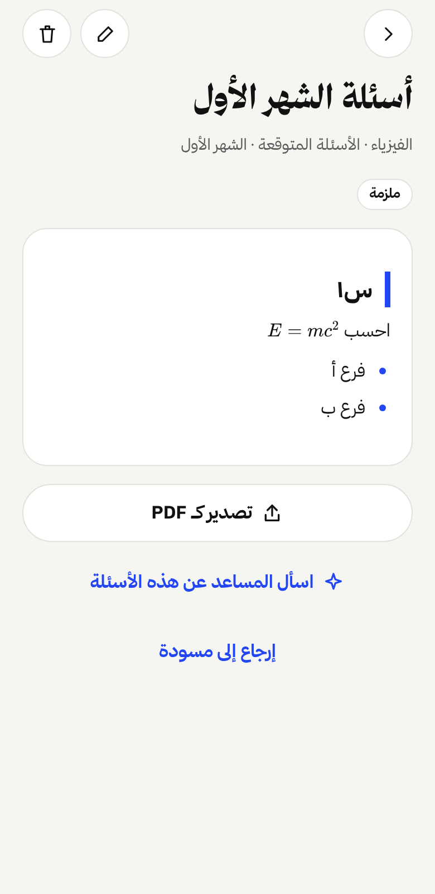<br/>الأسئلة المتوقعة</td>
</tr>
<tr>
<td align="center">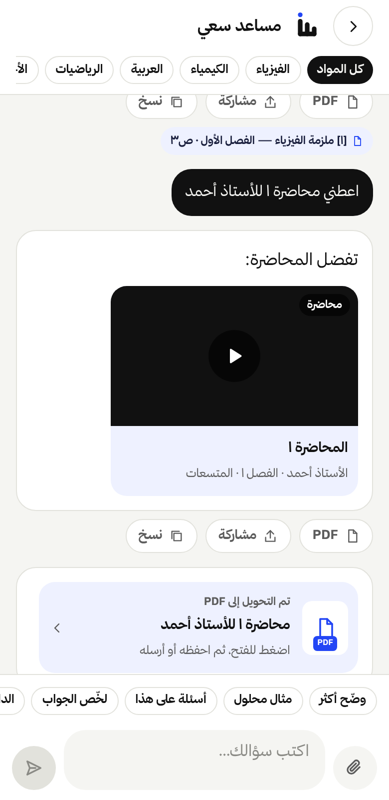<br/>مساعد سعي</td>
<td align="center">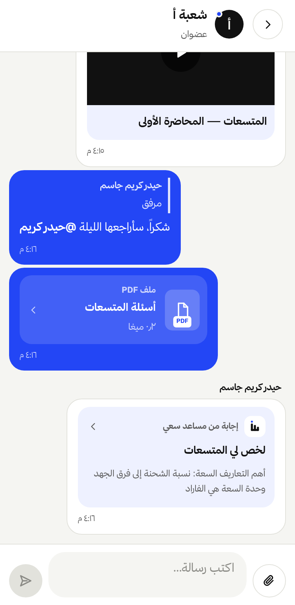<br/>دردشة الشعبة</td>
<td align="center">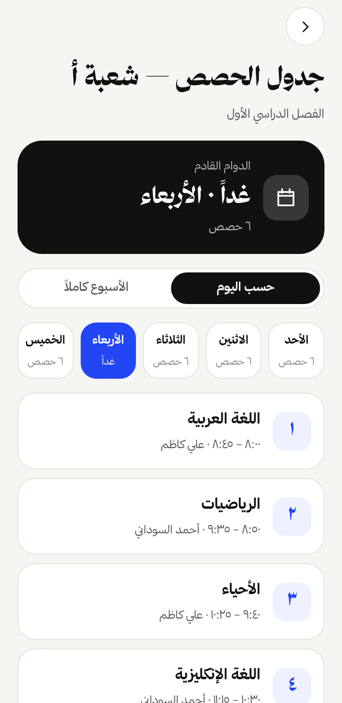<br/>جدول الحصص</td>
<td align="center">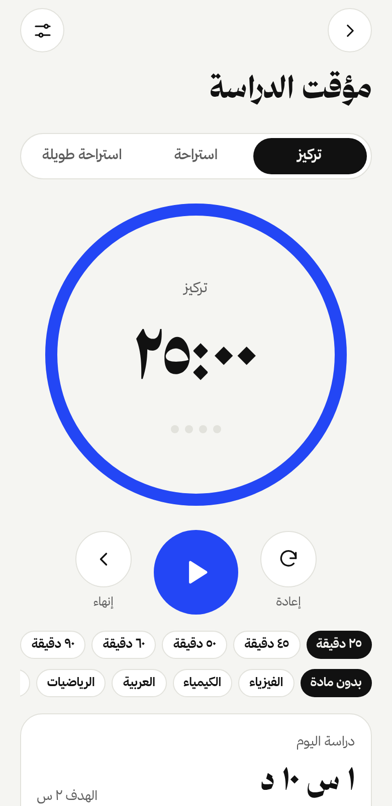<br/>مؤقت الدراسة</td>
</tr>
<tr>
<td align="center">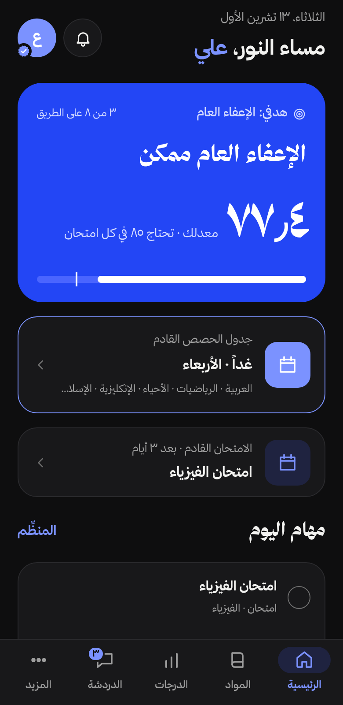<br/>الرئيسية (داكن)</td>
<td align="center">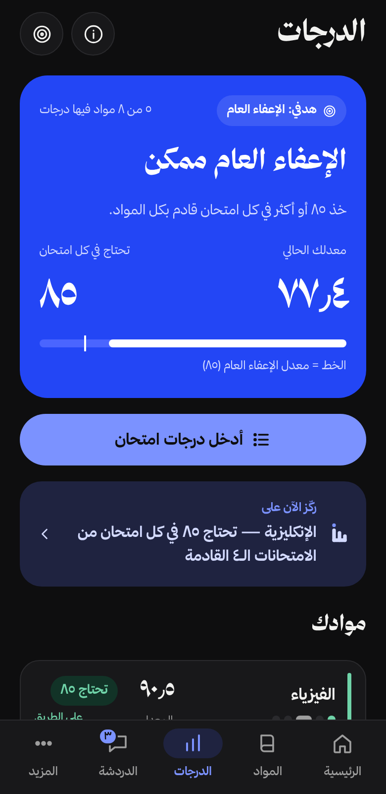<br/>الدرجات (داكن)</td>
<td align="center">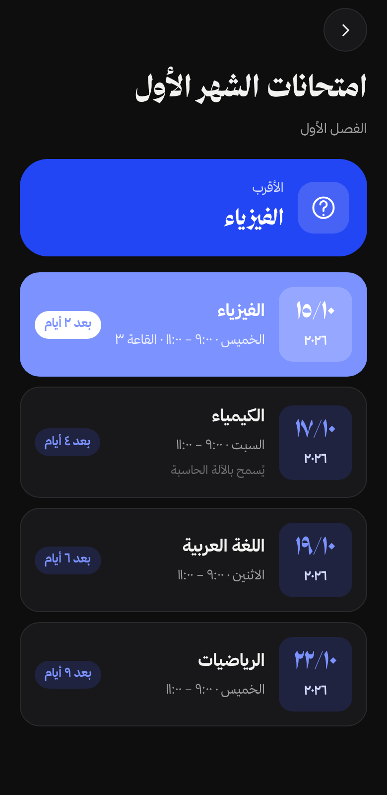<br/>جدول الامتحانات (داكن)</td>
<td align="center">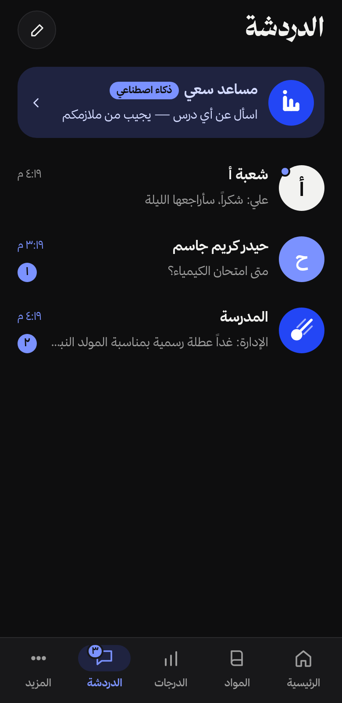<br/>المحادثات (داكن)</td>
</tr>
</table>

كل الشاشات (٢٥ شاشة بالوضعين) في [`screenshots/light`](screenshots/light) و [`screenshots/dark`](screenshots/dark).

### لوحة التحكم

| نظرة عامة | الكتب والملازم |
|:---:|:---:|
| 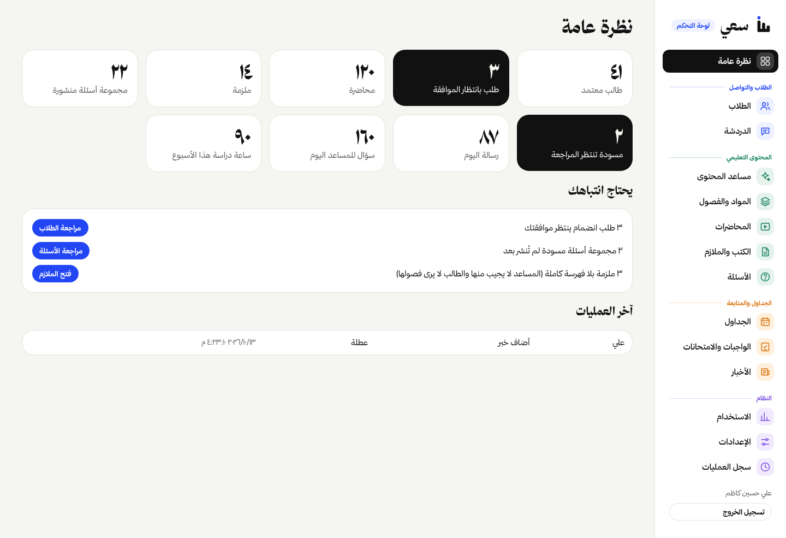 | 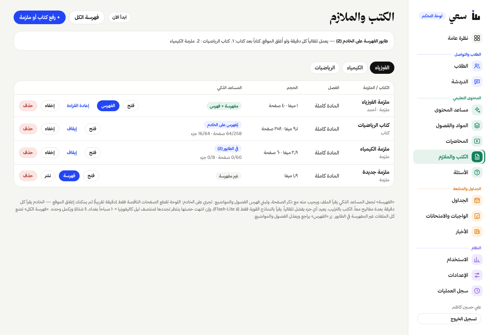 |

بقية صفحات اللوحة في [`screenshots/dashboard`](screenshots/dashboard).

## كيف بُني

| الجزء | التقنية |
|---|---|
| تطبيق الهاتف | React Native + Expo (SDK 57)، Expo Router، TypeScript |
| لوحة التحكم | React 19 + Vite |
| الخادم وقاعدة البيانات | Supabase (Postgres، صلاحيات على مستوى الصف RLS، Realtime، Storage) |
| دوال الخادم | Deno Edge Functions — المساعد، الفهرسة، OCR، الاختبارات، الإشعارات |
| الذكاء الاصطناعي | Google Gemini — إجابة من الملازم (RAG) مع ذكر الصفحة، وفهرسة الملازم والمحاضرات |
| الإشعارات | Firebase Cloud Messaging |
| ميزات أصلية | وحدة Kotlin خاصة لمؤقت الدراسة الحي، وويدجتات أندرويد |
| النشر | GitHub Actions: بناء APK موقّع، نشر الموقع واللوحة، ترحيلات قاعدة البيانات |

**بالأرقام:** نحو ٢٣ ألف سطر كود · ٢٦ ترحيلاً لقاعدة البيانات · ١٠ دوال خادم · اختبارات لحساب الإعفاء وصلاحيات قاعدة البيانات · ٣٠ إصداراً للتطبيق حتى الآن.

الهوية البصرية من تصميم المشروع نفسه: رمز السين بثلاث أسنان صاعدة (الفصل الأول، نصف السنة، الفصل الثاني) ونقطة زرقاء فوقها = **الإعفاء**.

## محتوى هذا المجلد

```
showcase/
├── README.md            ← هذا الملف
├── index.html           ← معرض كامل (صور + فيديوهات) يفتح في أي متصفح
├── cover.png            ← صورة الغلاف
├── icon.png             ← أيقونة التطبيق
├── videos/              ← فيديوهات MP4 للتطبيق وهو يعمل (+ posters/ صور مصغّرة)
├── gifs/                ← نسخ متحركة قصيرة من الفيديوهات
├── fonts/               ← خط ثمانية لصفحة المعرض
└── screenshots/
    ├── light/           ← ٢٥ شاشة بالوضع الفاتح
    ├── dark/            ← ٢٥ شاشة بالوضع الداكن
    └── dashboard/       ← صفحات لوحة التحكم
```

> الصور والفيديوهات مأخوذة من التطبيق الحقيقي (نسخة الويب من نفس الكود) ببيانات تجريبية — الأسماء والدرجات فيها للعرض فقط.

</div>
