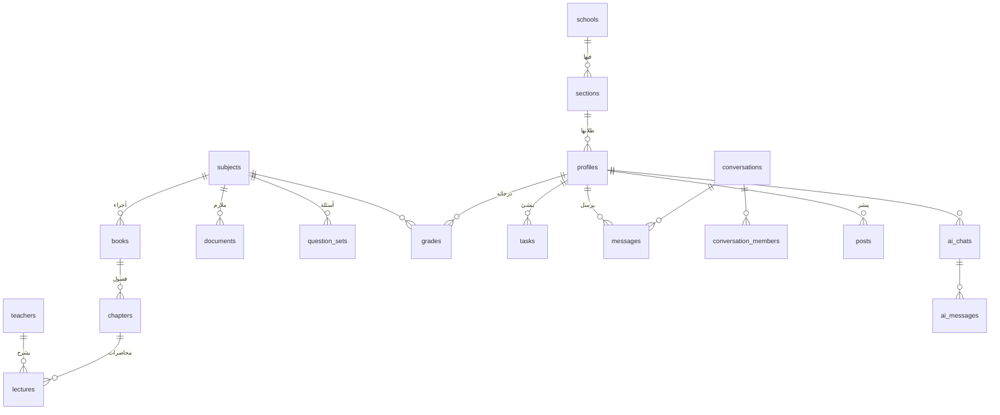

# تصميم قاعدة البيانات — Supabase (Postgres)

الحالة: ✅ معتمد ومنفّذ — الملفات في `supabase/migrations/` (المرجع الحقيقي هو SQL)

## المبادئ
1. **كل جدول محمي بـ RLS** — الطالب لا يرى ولا يعدّل إلا المسموح له، حتى لو عبث بالتطبيق.
2. **قابل للتوسع**: كل شيء مربوط بمدرسة وشعبة، فإضافة صفوف أو مدارس لاحقاً لا تحتاج إعادة تصميم.
3. **الأرقام الوزارية في الإعدادات** (`app_settings`) وليست في الكود.
4. **الملفات خارج قاعدة البيانات**: القاعدة تحفظ فقط «مفتاح» الملف؛ الملف نفسه في التخزين (Supabase Storage، حاوية `files` خاصة؛ أو R2/B2 إن أُضيفت أسراره).
5. **حذف ناعم** للرسائل والمحتوى (`deleted_at`) حتى لا يضيع شيء بالخطأ.

---

## خريطة الجداول



---

## ١. المستخدمون والمدرسة

### `schools`
| العمود | النوع | ملاحظة |
|---|---|---|
| id | uuid PK | |
| name | text | «إعدادية الشهاب للبنين» |
| grade_label | text | «الخامس العلمي» |

### `sections` — الشعب
| id | uuid PK | |
|---|---|---|
| school_id | uuid → schools | |
| name | text | أ، ب، ج… |
| sort | int | |

### `profiles` — مرتبط بحساب Google (`auth.users`)
| العمود | النوع | ملاحظة |
|---|---|---|
| id | uuid PK → auth.users | |
| full_name | text | الاسم الثلاثي (إلزامي، ٣ كلمات على الأقل) |
| avatar_url | text | رابط الصورة (Supabase Storage: avatars) |
| onboarded | bool | أكمل بيانات التسجيل |
| section_id | uuid → sections | |
| role | enum `student` `moderator` `admin` | يغيّره الأدمن فقط |
| status | enum `pending` `approved` `rejected` `banned` | يغيّره الأدمن فقط |
| is_verified | bool | **شارة التوثيق** |
| bio | text | اختياري |
| ai_daily_limit | int | حد أسئلة المساعد اليومي الخاص بالطالب (فارغ = الحد العام). الأدمن فقط (migration ٢٤) |
| created_at, last_seen_at | timestamptz | |

> مسار التسجيل: دخول Google ← شاشة إكمال البيانات ← `status = pending` ← شاشة «بانتظار الموافقة» ← الأدمن يوافق ← إشعار للطالب.

### `app_settings` — إعدادات يغيّرها الأدمن من لوحة التحكم
| key | value (jsonb) مثال |
|---|---|
| `grading` | `{"individual_exempt":90,"general_avg":85,"general_min":75,"pass":50,"round":"half_up"}` |
| `ai` | `{"daily_limit":20,"model":"gemini-2.5-flash","lite_model":"gemini-2.5-flash-lite"}` |
| `academic_year` | `{"label":"2026-2027","periods":{"month1":"2026-11-15",...}}` |
| `registration` | `{"open":true}` |

---

## ٢. المحتوى الدراسي

### `subjects`
| id | uuid PK |
|---|---|
| name | text — الفيزياء |
| slug | text — physics |
| icon | text |
| sort | int |

البيانات الأولية: الإسلامية، العربي، الإنكليزي، الرياضيات، الفيزياء، الكيمياء، الأحياء، الحاسوب.

### `books` — أجزاء المادة
| id | uuid PK | |
|---|---|---|
| subject_id | uuid → subjects | |
| name | text | «الجزء الأول» / «الجزء الثاني» / «كتاب الطالب» |
| sort | int | |

كل مادة لها كتاب واحد على الأقل. العربي له جزءان. في الواجهة: إذا كان للمادة كتاب واحد لا يظهر هذا المستوى أبداً.

### `chapters`
| id | uuid PK | |
|---|---|---|
| book_id | uuid → books | |
| number | int | |
| title | text | |
| sort | int | |

### `teachers`
| id | uuid PK |
|---|---|
| name | text |
| subject_id | uuid → subjects |
| channel_url | text — قناة يوتيوب |

### `lectures` — المحاضرات (يوتيوب)
| العمود | النوع | ملاحظة |
|---|---|---|
| id | uuid PK | |
| chapter_id | uuid → chapters | |
| teacher_id | uuid → teachers | |
| title | text | |
| youtube_id | text | يُستخرج تلقائياً من الرابط في لوحة التحكم |
| duration_sec | int | يُجلب تلقائياً |
| sort | int | |
| is_published | bool | |

### `documents` — الملازم والملفات
| العمود | النوع | ملاحظة |
|---|---|---|
| id | uuid PK | |
| subject_id | uuid → subjects | |
| chapter_id | uuid → chapters, nullable | فارغ = الملزمة تغطي المادة كلها |
| teacher_id | uuid → teachers, nullable | |
| kind | enum `malzama` `summary` `book` `other` | |
| title | text | |
| file_key | text | مفتاح الملف في التخزين |
| size_bytes, pages | int | |
| sort, is_published | | |

### `question_sets` — الأسئلة المتوقعة + أسئلة امتحانات المدرسة
| العمود | النوع | ملاحظة |
|---|---|---|
| id | uuid PK | |
| subject_id | uuid → subjects | |
| kind | enum `expected` `school_exam` | متوقعة / «امتحاناتنا» |
| period | enum `month1` `month2` `midyear` `month3` `month4` `final` | |
| section_id | uuid, nullable | لامتحان شعبة معينة |
| title | text | |
| source | text | مثلاً اسم الأستاذ أو «امتحان الشعبة ب» |
| content_md | text | النص المستخرج (Markdown + LaTeX للمعادلات) |
| pdf_key | text | PDF المُنتج |
| scan_keys | text[] | الصور الأصلية |
| status | enum `draft` `published` | المسودة تُراجع قبل النشر |
| created_by | uuid → profiles | |

---

## ٣. الدرجات والإعفاء

### `grades`
| العمود | النوع | ملاحظة |
|---|---|---|
| id | uuid PK | |
| user_id | uuid → profiles | |
| subject_id | uuid → subjects | |
| period | enum (نفس `question_sets.period`) | |
| score | numeric(5,2) | من 0 إلى 100 |
| note | text | |
| UNIQUE | (user_id, subject_id, period) | درجة واحدة لكل امتحان |

**الحسابات لا تُخزّن** — تُحسب دائماً من الدرجات + `app_settings.grading` بمكتبة مشتركة واحدة
(`packages/shared/grading.ts`) يستخدمها التطبيق ولوحة التحكم:
```
الفصل الأول  = معدل (month1, month2) المتوفر — شهر واحد كحد أدنى
الفصل الثاني = معدل (month3, month4) المتوفر
السعي       = (الفصل الأول + نصف السنة + الفصل الثاني) ÷ ٣
المطلوب في الفصل الثاني للوصول إلى هدف T = 3T − الفصل الأول − نصف السنة
  ← إذا > 100: «غير ممكن»، ← إذا كان شهر ٣ معروفاً: المطلوب في شهر ٤ = 2×المطلوب − شهر ٣
الإعفاء الفردي: السعي ≥ individual_exempt
الإعفاء العام : معدل السعي لكل المواد ≥ general_avg  و  أقل مادة ≥ general_min
```

---

## ٤. المنظِّم والتقدم

### `tasks` — واجبات، تحضيرات، امتحانات
| العمود | النوع | ملاحظة |
|---|---|---|
| id | uuid PK | |
| scope | enum `personal` `section` `school` | شخصي / للشعبة / للجميع |
| owner_id | uuid → profiles | المنشئ |
| section_id | uuid, nullable | عند `scope = section` |
| subject_id | uuid, nullable | |
| type | enum `homework` `preparation` `exam` `other` | |
| title, notes | text | |
| due_at | timestamptz | الامتحانات تُغذّي **العدّاد التنازلي** |
| remind_at | timestamptz | |

> الطالب ينشئ مهام شخصية؛ الأدمن والمشرف ينشئون مهام للشعبة أو للجميع.

### `task_status`
| task_id, user_id | PK | |
|---|---|---|
| done_at | timestamptz | |

### `progress` — تتبع التقدم
| user_id, item_type, item_id | PK | item_type: `lecture` / `chapter` |
|---|---|---|
| state | enum `watched` `studied` `reviewed` | |
| updated_at | | |

### `study_sessions` — مؤقت الدراسة
| id | uuid PK |
|---|---|
| user_id, subject_id | |
| started_at | timestamptz |
| minutes | int |

---

## ٥. الأخبار والإشعارات

### `posts`
| العمود | النوع | ملاحظة |
|---|---|---|
| id | uuid PK | |
| author_id | uuid → profiles | |
| kind | enum `news` `holiday` `exam` `urgent` | |
| title, body | text | |
| cover_key | text | |
| section_id | uuid, nullable | فارغ = للجميع |
| is_pinned | bool | |
| published_at | timestamptz | يمكن جدولة النشر |

### `push_tokens`
| user_id, token | PK |
|---|---|
| platform, updated_at | |

### `notifications` — سجل الإشعارات داخل التطبيق
| id, user_id, type, payload jsonb, read_at, created_at |
|---|

---

## ٦. الدردشة (Supabase Realtime)

### `conversations`
| العمود | النوع | ملاحظة |
|---|---|---|
| id | uuid PK | |
| type | enum `school` `section` `group` `direct` | عامة / شعبة / مجموعة / خاصة |
| section_id | uuid, nullable | |
| title | text | |
| only_staff_can_post | bool | لقنوات الإعلانات |

### `conversation_members`
| conversation_id, user_id | PK |
|---|---|
| last_read_at | timestamptz — عدد غير المقروء |
| muted | bool |

> مجموعة المدرسة ومجموعات الشعب: العضوية تُضاف تلقائياً عند موافقة الأدمن على الطالب.

### `messages`
| العمود | النوع | ملاحظة |
|---|---|---|
| id | uuid PK | |
| conversation_id | uuid | |
| sender_id | uuid → profiles | |
| body | text | |
| reply_to_id | uuid, nullable | الرد على رسالة |
| attachment | jsonb | `{"type":"image","key":…}` أو `{"type":"lecture","id":…}` أو `document` / `question_set` |
| mentions | uuid[] | التاغ @ ← إشعار للمذكور |
| created_at, edited_at, deleted_at | | |

### `message_reactions`
| message_id, user_id, emoji | PK |
|---|---|

---

## ٧. المساعد الذكي

### `ai_chats` / `ai_messages`
| ai_chats: id, user_id, title, subject_id, plan jsonb (خطة الشرح المقسّم: title, documentId, docTitle, parts[{from,to}], next, ids[]), created_at |
|---|
| ai_messages: id, chat_id, role (`user`/`assistant`), content, sources jsonb, created_at |

### `ai_usage`
| user_id, day | PK |
|---|---|
| count | int — يُقارن بـ `profiles.ai_daily_limit` أو `app_settings.ai.daily_limit` |

> `app_settings.ai_scope` = `{subject_id: نص}` حدود المقرر لكل مادة (الداخل في الامتحان وما هو للاطلاع) يلتزم بها المساعد.
> `admin_clear_chats(p_conversation uuid default null)`: مسح الدردشات للأدمن (محادثة واحدة أو الكل؛ الخاصة تُحذف، المدرسة والشعب والمجموعات تبقى بلا رسائل).

### `content_chunks` — المنهج مقطّعاً للبحث (pgvector)
| العمود | النوع |
|---|---|
| id | uuid PK |
| source_type | `document` / `question_set` |
| source_id, subject_id, chapter_id | uuid |
| page | int |
| content | text |
| embedding | vector(768) |

### `quiz_questions` / `quiz_attempts` — الاختبارات الذاتية
تُولَّد مرة واحدة لكل فصل وتُحفظ وتُعاد (توفيراً لطلبات الذكاء الاصطناعي).

---

## ٨. الإدارة

### `audit_log`
| id, actor_id, action, target_type, target_id, meta jsonb, created_at |
|---|
كل عملية للأدمن/المشرف (موافقة، حذف، نشر…) تُسجّل هنا.

---

## الصلاحيات (RLS) — ملخص
| الجدول | الطالب | المشرف | الأدمن |
|---|---|---|---|
| المحتوى (subjects…question_sets) | قراءة المنشور | إضافة/تعديل | كل شيء |
| profiles | قراءة المعتمَدين، تعديل اسمه وصورته | — | كل شيء + role/status/is_verified |
| grades | **درجاته فقط** | ❌ | قراءة الكل |
| tasks | الشخصية + مهام شعبته | إنشاء للشعبة | كل شيء |
| posts | قراءة | نشر | كل شيء |
| messages | المحادثات التي هو عضو فيها، حذف رسائله | حذف أي رسالة | كل شيء |
| ai_* | بياناته فقط | — | قراءة الكل |
| app_settings | قراءة | قراءة | تعديل |

دوال مساعدة: `is_admin()`، `is_staff()`، `is_approved()`.
**أي مستخدم حالته ليست `approved` لا يقرأ أي شيء** سوى ملفه الشخصي.

---

## تخزين الملفات
| الملفات | المكان | الوصول |
|---|---|---|
| الملازم PDF، صور الامتحانات، صور الدردشة، PDF المُنتج | **Supabase Storage** (حاوية `files` خاصة، ٥٠ ميغا للملف) | روابط مؤقتة موقّعة تصدرها Edge Function بعد التحقق من الصلاحية |
| الصور الشخصية (مضغوطة ≤ 100KB) | Supabase Storage | للطلاب المعتمدين |

## تقدير الحجم (سنة دراسية، ~40 طالب)
| | الحجم |
|---|---|
| قاعدة البيانات (نصوص، رسائل، درجات، مقاطع المنهج) | ≈ 100–200 MB من 500 MB ✅ |
| Supabase Storage (ملازم + صور) | ≈ 1 GB مجاناً — عند الامتلاء ننتقل إلى B2/R2 (الكود جاهز) ⚠️ |
| Supabase Storage (صور شخصية) | ≈ 5 MB من 1 GB ✅ |
